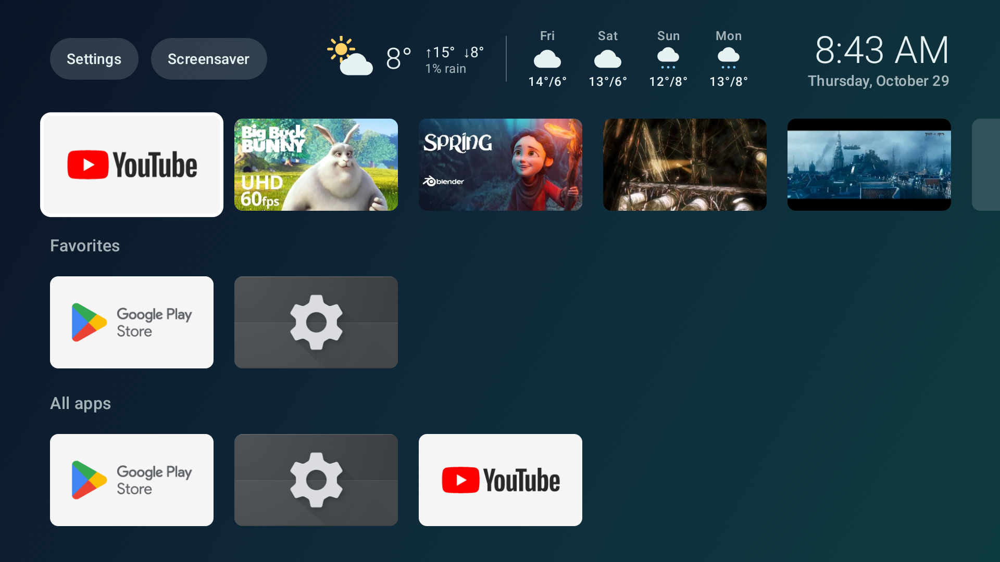

# Television homescreen

A replacement home screen for a Chromecast with Google TV: no ads and no recommendations, just the apps and shows we actually use, the time and the weather. It runs on a Chromecast HD (Android 14) in our kitchen.



*On the emulator, with the debug build's demo row of Blender open movies. On the TV, rows hold the shows we picked for Netflix, Disney+ and Videoland.*

## What it does

- **Show rows.** One row per app with picked shows: the app's tile first, then its shows. Selecting a show opens it in the app by deep link. The list lives in [`shows.json`](app/src/main/assets/shows.json); artwork is downloaded once and cached.
- **Favorites and all apps.** Favorites can be added, removed and reordered with a long press on OK. Apps that have a show row aren't repeated in Favorites.
- **Weather.** Today and the next four days from [Open-Meteo](https://open-meteo.com/), refreshed every 30 minutes and cached for offline use.
- **Screensaver.** The header's Screensaver button, or BACK on the home screen, starts the normal Ambient screensaver.
- **Fast on old hardware.** No live shaders; the background gradient is pre-rendered.

## How it replaces the stock home screen

Google TV's own launcher can't be outranked as the HOME app, and disabling it breaks things that depend on it, such as Google Photos in Ambient and the TV's entry in Google Home. So the stock launcher stays enabled, and an accessibility service in this app ([`HomeRedirectService`](app/src/main/java/me/steenman/tvlauncher/HomeRedirectService.kt)) brings this launcher up whenever the stock home screen appears. The service only sees which app opened a window; it doesn't read the screen or key presses.

The full story, including the approaches that didn't work, is in [`openspec/changes/`](openspec/changes/), in particular `kitchen-launcher-poc` and `takeover-redirect`.

## Building

Requirements: JDK 17+, the Android SDK (platform 37), and for the emulator the `google-tv` Android 34 system image.

Optional settings in `local.properties` (git-ignored):

```properties
# Weather location; without these, the weather strip stays hidden.
weather.latitude=52.10
weather.longitude=5.18
```

Release builds are signed with a local key described by `keystore.properties` (git-ignored); see [`docs/release-signing.md`](docs/release-signing.md).

```bash
./gradlew testDebugUnitTest
```

## Scripts

All in [`scripts/`](scripts/), run from the repository root:

| Script | What it does |
|---|---|
| `emulator.sh` | Creates (once) and boots the `gtv-34` Google TV emulator |
| `deploy.sh [tv\|emulator] [--release]` | Builds, installs and starts the launcher |
| `device.sh` | Connects to the TV over wireless debugging, finding its port via mDNS |
| `takeover-c.sh` | Makes this the home screen on the TV (the approach in use) |
| `restore-stock.sh` | Undoes every takeover change and returns the TV to the stock launcher |

`device.sh` uses the only device advertising wireless debugging. With several, set `TV_MDNS_NAME=adb-<serial>` in `scripts/local.env` (git-ignored). Wireless debugging switches itself off on every reboot and has to be switched on again on the TV.

## Development

Changes are planned with [OpenSpec](https://github.com/Fission-AI/OpenSpec): each folder in `openspec/changes/` has a proposal, design, specs and tasks. On-device tests run on the emulator:

```bash
ANDROID_SERIAL=emulator-5554 ./gradlew connectedDebugAndroidTest
```
